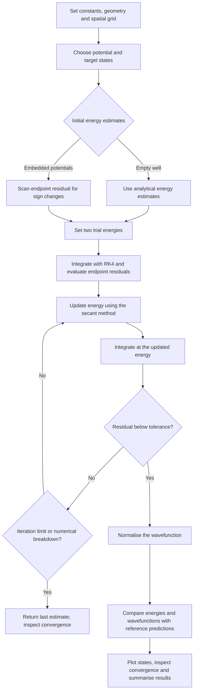

# Quantum Wells with the Shooting Method

A Python investigation of the one-dimensional time-independent Schrödinger equation using a fourth-order Runge–Kutta integrator and secant root finding.

Developed for the UCL PHAS0029 Computing final assignment (2026), this notebook explores how confinement and potential shape affect electron energy levels and wavefunctions. The numerical methods are implemented directly with NumPy; Matplotlib is used to visualise the results.

**Suggested repository name:** `quantum-well-shooting-method`

## Overview

The project starts with an infinite square well, where exact solutions provide a benchmark, then applies the same solver to harmonic and finite square potentials inside the infinite walls.

The notebook includes:

- An RK4 implementation for coupled first-order differential equations.
- Shooting with secant iteration to search for energy eigenvalues.
- Wavefunction normalisation and comparisons with analytical solutions.
- Low-lying states and higher states at quantum numbers 17 and 22.
- Grid refinement and sensitivity to initial energy guesses.
- Potential profiles, wavefunction plots, energy comparisons, and a results summary.

## Physical model

An electron is confined to a well of width $d=6\,\mathrm{nm}$, with $a=d/2=3\,\mathrm{nm}$ and boundary conditions $\psi(-a)=\psi(a)=0$.

The time-independent Schrödinger equation is

$$
-\frac{\hbar^2}{2m_e}\frac{d^2\psi}{dx^2}+V(x)\psi=E\psi.
$$

The three interior potentials are:

| Model | Potential inside the outer walls | Parameters |
| --- | --- | --- |
| Infinite square well | $V(x)=0$ | Width: 6 nm |
| Embedded harmonic potential | $V(x)=V_0(x/a)^2$ | $V_0=850\,\mathrm{eV}$ |
| Embedded finite square well | Zero for $\lvert x\rvert\leq a/2$; $V_0$ elsewhere | $V_0=500\,\mathrm{eV}$; central width: 3 nm |

All three systems retain infinite outer walls. The embedded finite well therefore differs from an isolated finite well extending into an unbounded exterior.

## Numerical approach

Introducing $\phi=d\psi/dx$ gives

$$
\frac{d\psi}{dx}=\phi,\qquad
\frac{d\phi}{dx}=\frac{2m_e}{\hbar^2}[V(x)-E]\psi.
$$

For each trial energy, RK4 propagates the initial conditions $\psi(-a)=0$ and $\phi(-a)=1$ across a default grid of 2,400 points. The initial derivative sets an arbitrary amplitude, which is removed by normalisation.

The endpoint residual $g(E)=\psi(a;E)$ measures the boundary mismatch. The secant method updates the energy to seek a zero of this residual. Initial energy pairs come from analytical estimates for the empty well or sign changes in a coarse energy scan for the embedded potentials.

After solving, the wavefunction is normalised by numerical integration so that $\int_{-a}^{a}|\psi|^2\,dx=1$.

## Project workflow



The diagram follows the implemented search. A sign-changing interval supplies starting estimates; the secant iteration does not preserve that interval. Repeat the search for each requested state and potential.

## Infinite-well benchmark

For the empty infinite well,

$$
E_n=\frac{\pi^2\hbar^2n^2}{2m_ed^2}.
$$

The notebook's saved outputs report:

| Quantum number | Numerical energy (eV) | Relative error against the exact energy |
| --- | --- | --- |
| 1 | 0.01044528 | $1.24\times10^{-14}$ |
| 2 | 0.04178113 | $7.48\times10^{-13}$ |
| 3 | 0.09400754 | $3.93\times10^{-12}$ |
| 4 | 0.16712452 | $1.25\times10^{-11}$ |

These states reproduce the expected energy ratios $1:4:9:16$. The notebook also compares the $n=17$ and $n=22$ states with analytical solutions and repeats the ground-state calculation on grids of 1,200, 1,800, and 2,400 points. These figures describe the stored notebook outputs; they are not a new independent execution.

## Run the notebook

The supplied notebook records Python 3.12.7. A compatible starting environment is Python 3.12 with NumPy 1.26 and Matplotlib 3.8. These dependency versions are suggested for compatibility, rather than an exact recovered environment lockfile.

```bash
python -m venv .venv
```

Activate the environment:

```bash
# Windows PowerShell
.venv\Scripts\Activate.ps1

# macOS / Linux
source .venv/bin/activate
```

Install the dependencies and start Jupyter:

```bash
python -m pip install "numpy>=1.26,<2" "matplotlib>=3.8,<4" jupyterlab ipykernel
python -m jupyter lab
```

Open `24011579_PHAS0029_Final.ipynb`, select the environment's Python kernel, and run the cells from top to bottom. All potentials and constants are defined in the notebook; no external dataset is required. The embedded-potential scans evaluate thousands of trial energies and are the most time-consuming sections.

## Numerical limitations

- **Root selection:** a coarse scan can miss multiple roots between adjacent samples. Secant iteration may converge to a different state or reach the iteration limit; the current return values do not provide an explicit success flag.
- **Embedded potentials:** shooting across strongly forbidden regions amplifies growing solutions and round-off errors. Their spectra and normalised wavefunctions need further verification, for example with node counting, two-sided matching, or a finite-difference eigenvalue solver.
- **Finite-well comparison:** the saved transcendental-equation estimate (about 1.0300 eV) differs from the first reported shooting energy (about 0.37178 eV) and from the accompanying discussion. Neither the ground-state identification nor agreement with that reference is established by the current output. A scan of a tangent equation must also distinguish roots from poles.
- **Tolerance and convergence:** the code compares the wavefunction endpoint residual with the numerical value `eV/200000`. This is not a dimensionally defined energy-error tolerance. The three finest-grid errors also approach floating-point precision, so their fitted slope alone does not establish RK4's asymptotic convergence order.
- **Plot units:** normalisation uses metres, so the resulting wavefunction has units of $\mathrm{m}^{-1/2}$; several notebook axes label it as $\mathrm{nm}^{-1/2}$ without rescaling.

The empty-well benchmark is the clearest validated part of this educational implementation. The embedded cases illustrate both the usefulness and the numerical challenges of shooting methods.

## Files

| File | Purpose |
| --- | --- |
| `24011579_PHAS0029_Final.ipynb` | Original computational report, solver implementations, plots, and saved outputs |
| `README.md` | Project description, setup instructions, workflow, and numerical limitations |
| `workflow.mmd` | Editable Mermaid source for the workflow diagram |
